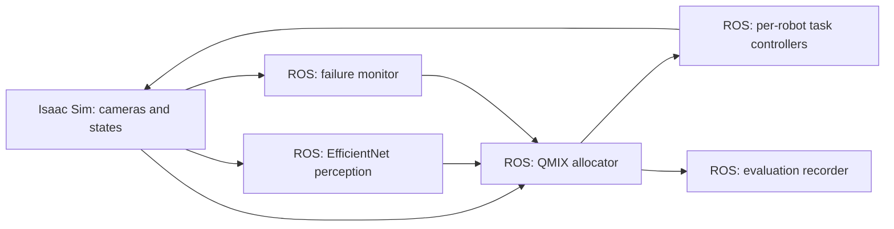

The camera-based ROS 2 research pipeline
=======================================

The new `isaac_sim/ros2_swarm_scene.py` references actual Isaac Sim Ridgeback–
Franka assets, creates one RGB camera per robot and keeps its overview camera
fixed. It is separate from the previous pick-and-place and NuRec entry points.
The ROS processes are in `src/disaster_mrta/disaster_mrta/ros_nodes.py`.



Run the verified integration demo
---------------------------------

Use two PowerShell terminals in this workspace. Start one robot first.

Terminal 1: build the package and run nodes in the existing WSL Humble setup:

```powershell
powershell.exe -ExecutionPolicy Bypass -File .\run_ros2_nodes.ps1 -Mode demo -Robots 1
```

Terminal 2: start the Windows Isaac simulation:

```powershell
powershell.exe -ExecutionPolicy Bypass -File .\run_ros2_isaac.ps1 -Robots 1
```

After stopping both, repeat with `-Robots 5` in both terminals. The node
launcher uses Ubuntu-22.04 and separate `build_ros2`, `install_ros2`, `log_ros2`
folders. `-Distro` and `-IsaacRoot` override the defaults on their respective
launchers. Domain 42 and Fast DDS are used on both sides.

**Demo mode explicitly uses mock perception, the priority/distance baseline,
kinematic base motion and timed task execution. It is not a trained QMIX or
EfficientNet result, and does not lift or deliver physical payloads.**

The five-robot integration run received all five camera streams and completed
all five demo tasks. The recorder reported a completion rate of 1.0, completion
times around 12.3 wall seconds, and estimated fleet battery use around 2.44
percentage points. These are integration-check results, not research performance
claims. A separate Windows/WSL probe received RGB, camera info, odometry and
status, and confirmed a 0.09m movement from a ROS `cmd_vel` command.

Platform setup
---------------

Isaac Sim 5.1's supported Windows arrangement runs ROS 2 Humble nodes in WSL2,
while the Windows simulator loads its bundled Python 3.11 ROS bridge libraries.
The existing Ubuntu-22.04 installation contains `/opt/ros/humble`, `rclpy`,
`cv_bridge`, `launch_ros`, and pytest. The Windows bridge and WSL DDS link were
tested on this machine; no firewall or network settings were changed.

See NVIDIA's [ROS installation instructions](https://docs.isaacsim.omniverse.nvidia.com/5.1.0/installation/install_ros.html)
and [camera publisher tutorial](https://docs.isaacsim.omniverse.nvidia.com/5.1.0/ros2_tutorials/tutorial_ros2_camera.html).
If using another machine, verify Windows/WSL DDS discovery before running the
allocator. Do not load WSL's Python 3.10 ROS modules into Isaac's Python 3.11.

The simulation enables `isaacsim.ros2.bridge`, creates camera-helper graphs
using 320x240 render products, and publishes RGB plus camera info every 12
simulation frames by default (nominally 5Hz at 60 simulation FPS). Actual wall
rate depends on rendering throughput. State heartbeats run in a separate ROS
executor at 20Hz; the monitor checks sequence changes at 10Hz. Camera and robot
state publishing starts with playback. `/simulation/playback` separately reports
intentional pauses so the pipeline stops commands and suspends missed-update
counting. It is not a robot health signal.

Interfaces
------------

| Topic | Type | Payload/purpose |
| --- | --- | --- |
| `/robot_i/camera/rgb` | `sensor_msgs/Image` | Mounted RGB camera; sensor-data QoS |
| `/robot_i/camera/camera_info` | `sensor_msgs/CameraInfo` | Camera intrinsics and optical frame |
| `/robot_i/odom` | `nav_msgs/Odometry` | Pose in `map`, child `robot_i/base_link` |
| `/robot_i/status` | `std_msgs/String` JSON | Robot ID, boot ID, sequence, XY, battery %, capabilities, health, communication |
| `/tasks/vision_result` | `std_msgs/String` JSON | Area, six class scores, class, confidence, hazard risk, rescue signal, source |
| `/robot_i/task_assignment` | `std_msgs/String` JSON | Task ID, assignment lease, generation, goal, capability, cost; or cancellation |
| `/robot_i/cmd_vel` | `geometry_msgs/Twist` | Body-frame XY and yaw velocity for the omnidirectional test adapter |
| `/robot_i/execute_task` | `std_msgs/String` JSON | External executor start/cancel request |
| `/robot_i/task_result` | `std_msgs/String` JSON | External executor completion/failure, with the same assignment lease |
| `/tasks/feedback` | `std_msgs/String` JSON | Controller in_progress/completed/failed feedback |
| `/tasks/route_status` | `std_msgs/String` JSON | Explicit `{task_id, safe}` route update |
| `/tasks/state` | `std_msgs/String` JSON | Task states, ownership, robot states and allocator backend |
| `/fleet/failure` | `std_msgs/String` JSON | Detected outage/health failure |
| `/fleet/inject_failure` | `std_msgs/String` JSON | Test-only simulator communication failure/recovery |
| `/pipeline/events` | `std_msgs/String` JSON | Accepted assignments, completion and failure/reassignment events |

Standard ROS messages plus JSON avoid building custom Windows/Python ABI
message packages. The prefixes above are `robot_1` through `robot_5`.

The controller sends an external executor the original assignment plus
`action: start`. Reply to `/robot_i/task_result` with:

```json
{"robot_id":"robot_1","task_id":"0","assignment_id":"same-lease-from-assignment","status":"completed"}
```

Results are accepted only after the controller has arrived and begun execution.
The allocator also requires an in_progress task and rejects old lease IDs,
including delayed results after reassignment. Cancellation carries the old
lease; the executor must stop only the matching operation.

Feasibility, failure and control
--------------------------------

`pipeline_core.py` gates assignments on battery >=20%, healthy/online active
communication, matching capability, no current task, pending task status and
distance <=50m. Delivery additionally requires explicit route safety. The
controlled demo marks its unobstructed delivery route safe; a real deployment
must provide a planner's decision through `/tasks/route_status`.

Object/task ownership is committed centrally and atomically. The monitor emits
one outage event after three consecutive 0.1s intervals with no new status
sequence. The unfinished task becomes pending, the old controller is cancelled,
and allocation runs again. Boot IDs handle restarted sequence counters; retired
boot packets and stale completion messages cannot reclaim a task. Explicit
unhealthy/communication-false status also causes a failure. The base adapter
stops stale velocity commands after 0.3s.

The included goal controller uses body-frame proportional velocity on a clear
open floor. The simulator moves whole Ridgeback USD roots kinematically with
native robot physics disabled; wheel and arm joints stay parked. This is not
Nav2, collision-aware navigation, physical wheel control, or grasp execution.
Keep the allocation interfaces and replace this low-level adapter/controller
with the required navigation and manipulator executors for physical experiments.
The earlier geometrically verified pick/place demonstration remains available
through `run_five_robot_pick_place.ps1`; it is not silently substituted for a
ROS executor on the new Ridgeback assets.

EfficientNet and QMIX trained mode
----------------------------------

No `.keras`, `.h5`, `.pt`, `.pth`, ONNX, SavedModel, or other common checkpoint
was found under the archive directory supplied in this session. TensorFlow and
PyTorch were also absent from the checked Humble Python environment. The
trained backends fail at startup when files/dependencies are missing; no random
policy or synthetic image scores are used as trained inference.

Install inference dependencies in a ROS-compatible Python 3.10 environment
matching the training libraries before using trained mode. Keep NumPy compatible
with Humble's binary cv_bridge (NumPy 1.x in this installation). Configure the
trained Keras model path and a compatible QMIX checkpoint:

```powershell
powershell.exe -ExecutionPolicy Bypass -File .\run_ros2_nodes.ps1 -Mode trained -Robots 5 -EfficientNetModel "D:\path\efficientnet.keras" -QmixCheckpoint "D:\path\qmix.pt"
```

The launcher converts Windows paths to WSL paths. Alternatively, in a sourced
and built Humble terminal:

```bash
ros2 launch disaster_mrta vision_mrta.launch.py robot_count:=5 \
  allocator_backend:=qmix perception_backend:=efficientnet execution_backend:=external \
  efficientnet_model:=/path/to/efficientnet.keras qmix_checkpoint:=/path/to/qmix.pt
```

`perception_model.py` resizes RGB to 224x224 and supports `input_range` values
`0_255` or `0_1` and `model_output` values `probabilities` or `logits`. These MUST
match training. Class order is configured in `config/ros2_pipeline.yaml` and
must match the saved model. Inference runs outside Isaac in a single worker;
only the latest frame per robot is queued. Camera-to-area association is an
explicit configuration for the controlled scene; it is not inferred victim or
area localization. Human Damage only raises an area-search clue.

`qmix_policy.py` defines a shared GRU agent and a monotonic state-conditioned
QMIX mixer. It loads learned state dictionaries with `weights_only=True` and
strict shape checks. The mixer is used during QMIX training; execution uses
masked individual Q values, with centralized duplicate-task conflict resolution.
No training run or checkpoint is fabricated. Existing checkpoints with different
architectures/features need a deliberate adapter or retraining.

Checkpoint keys: `metadata`, `agent_state_dict`, `mixer_state_dict`. Metadata:

```json
{"feature_schema":"area_tasks_v1","n_agents":5,"max_tasks":8,"obs_dim":69,"hidden_dim":64}
```

Agent observations start with `[x/50, y/50, battery/100, healthy_online, busy]`,
then eight features per task: relative XY/50, priority, hazard risk, rescue
signal, confidence, pending, feasible. Tasks are zero padded to `max_tasks`.
The network also receives agent one-hot ID and previous-action one-hot, and
maintains recurrent hidden state. Action 0 is idle; task actions follow catalog
order. Mixer state concatenates the five observations. Supply/test capabilities
are scenario assumptions, not certifications of resistance or sensing hardware.

This is the camera-based research system. An aspiration-level variable called
“vision” in a separate paper is not the image classifier here; the implementation
does not claim to reproduce that paper's aspiration mechanism.

Tests and evaluation
---------------------

Pure core tests cover feasibility boundaries, unique assignment, stale leases,
restart recovery, three-missed-update failure timing, and whole-image semantics.
The real Humble process test uses separate nodes and simulated robot I/O:

```bash
bash scripts/test_humble_pipeline.sh
```

It verifies image transport, perception messages, assignment, an intentional
pause without a false outage, actual lost updates, reassignment and timed-demo
completion. `scripts/probe_isaac_ros.sh` additionally verifies live Windows Isaac
RGB/info/state topics and movement across DDS; start it before the simulator.

`evaluation_recorder` writes JSONL events and `results/ros2/latest_summary.json`:
completion rate, per-task wall duration, estimated battery percentage used,
reassignment delay and detection accuracy. Accuracy remains null without
explicit ground-truth labels and non-mock predictions. Battery is a modelled
percentage, not measured energy in joules. Reassignment delay starts when the
allocator receives the failure event; monitor detection delay is separate.
Intentional pauses are excluded from controller execution timers, although
the recorder's end-to-end wall duration includes them.

Inject a simulator communication outage in a sourced WSL terminal:

```bash
ros2 topic pub --once /fleet/inject_failure std_msgs/msg/String '{data: "{\"robot_id\":\"robot_1\",\"failed\":true}"}'
```

Use `false` to recover. A missing reporter becomes unavailable; an unseen robot
is unavailable from startup. If no capable healthy robot is free, its task stays
pending instead of being assigned unsafely. Stop ROS nodes with Ctrl+C before
starting another run on the same DDS domain.
